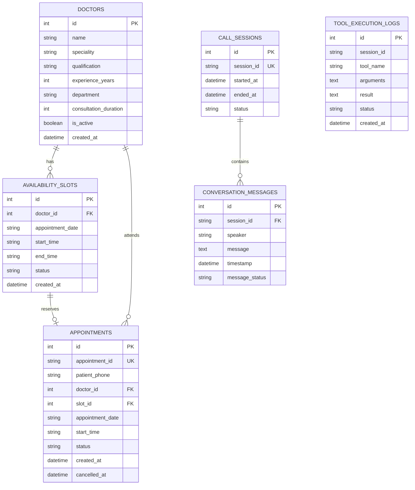

# MediVoice — AI Voice Doctor Appointment Assistant

[](https://www.python.org/)
[](https://fastapi.tiangolo.com/)
[](https://pipecat.ai/)
[](https://ai.google.dev/)
[](https://elevenlabs.io/)
[](https://react.dev/)
[](https://tailwindcss.com/)
[](https://sqlite.org/)
[](tests/)

---

## 1. Project Overview & Problem Statement
Healthcare clinics process hundreds of appointment calls daily. Traditional phone IVR menus are rigid, slow, and frustrating, while human receptionists are overburdened during peak morning consultation hours.

**MediVoice** solves this by providing an autonomous, ultra-low-latency real-time voice appointment receptionist:
- Natural, conversational turn-taking via **Silero VAD**.
- Accurate speech recognition via **ElevenLabs STT**.
- Contextual understanding and function calling via **Google Gemini 2.0 Flash**.
- High-fidelity human speech output via **ElevenLabs TTS**.
- Concurrency-safe atomic database operations via **SQLite + SQLAlchemy**.
- Live frontend dashboard updates via **WebSockets**.

**Non-Negotiable Production Standard**: Every operation works end-to-end. There are zero simulated bookings, fake AI responses, or fabricated doctor slots.

---

## 2. Key Features
- **Phone-Style Interactive Voice Call Modal**: Sleek glassmorphic call interface with real-time call timer, live transcript, and audio visualizer.
- **Audio-Reactive Waveform**: Real-time multi-bar waveform driven directly by microphone frequency levels via the Web Audio API.
- **Mandatory Caller Identification**: Callers identify themselves exclusively via a spoken 10-digit mobile number repeated back digit-by-digit (`9-8-7-6-5-4-3-2-1-0`) for explicit confirmation.
- **Strict Separation of Confirmations**: Phone confirmation and booking authorization are handled as two distinct sequential steps.
- **Atomic Booking Engine**: Concurrency-safe slot reservation with unique database constraints to prevent double booking.
- **Real-Time Live Dashboard Sync**: The dashboard automatically highlights new appointments, updates available slot counters, and refreshes doctor status without page reloads over WebSocket.
- **Comprehensive Audit Trail**: Every function call arguments (with phone numbers masked: `******3210`) and results are logged to persistent database tables.

---

## 3. Technology Stack

| Layer | Technology | Version | Purpose |
|---|---|---|---|
| **Voice Framework** | Pipecat | 1.17.0 | Real-time audio streaming, pipeline orchestration |
| **VAD** | Silero VAD | v5 / ONNX | Voice activity detection & turn-taking |
| **STT** | ElevenLabs | `scribe_v1` | High-accuracy speech-to-text |
| **LLM** | Google Gemini | `gemini-2.0-flash` | Intent parsing, reasoning & function calling |
| **TTS** | ElevenLabs | `eleven_turbo_v2_5` | Natural human voice speech synthesis |
| **Backend API** | FastAPI + Uvicorn | 0.110+ | REST endpoints & WebSockets |
| **Database** | SQLite + SQLAlchemy | 2.0+ | Persistent transactional storage |
| **Frontend UI** | React + Vite | React 19 / Vite 8 | Single-page SaaS dashboard |
| **Styling** | Tailwind CSS v4 | v4.0 | Modern dark healthcare theme |
| **Icons** | Lucide React | v1.80 | High-contrast UI iconography |
| **Testing** | Pytest + pytest-asyncio | 8.4+ | Automated unit, conflict & integration tests |

---

## 4. System Architecture

```text
+-----------------------------------------------------------------------------------+
|                           REACT FRONTEND DASHBOARD                                |
|  - Real-Time Phone Call Interface     - Live Conversation Transcript              |
|  - Audio-Reactive Waveform            - Doctors Directory & Availability Grid     |
|  - Appointments Management Table      - System Audit Activity Logs                |
+--------------------------+-------------------------------------+------------------+
                           |                                     ^
     Microphone Audio (WS) |                                     | Live Events (WS)
     & Spoken User Speech  |                                     | /ws/events
                           v                                     |
+----------------------------------------------------------------+------------------+
|                           FASTAPI VOICE BACKEND                                   |
|                                                                                   |
|  +-----------------------------------------------------------------------------+  |
|  |                      PIPECAT REAL-TIME VOICE PIPELINE                       |  |
|  |  FastAPIWebsocketTransport -> Silero VAD -> ElevenLabs STT -> Gemini LLM    |  |
|  |                           -> ElevenLabs TTS -> Audio Output                  |  |
|  +-------------------------------------+---------------------------------------+  |
|                                        | Function Calling                         |
|                                        v                                          |
|  +-----------------------------------------------------------------------------+  |
|  |                     SHARED APPOINTMENT SERVICE LAYER                        |  |
|  |  - check_doctor_availability()                                              |  |
|  |  - book_appointment()       [Atomic Concurrency Lock]                       |  |
|  |  - cancel_appointment()     [Slot Release]                                  |  |
|  +-------------------------------------+---------------------------------------+  |
|                                        |                                          |
|                                        v SQLAlchemy Transactions                  |
|  +-----------------------------------------------------------------------------+  |
|  |                            SQLITE DATABASE                                  |  |
|  |  Doctors | AvailabilitySlots | Appointments | CallSessions | ToolLogs       |  |
|  +-----------------------------------------------------------------------------+  |
+-----------------------------------------------------------------------------------+
```

---

## 5. Voice Pipeline Tools

The Google Gemini LLM has access to three registered function tools inside the Pipecat pipeline:

### Tool 1: `check_doctor_availability`
- **Purpose**: Returns actual available appointment slots from the database.
- **Parameters**: `doctor_name` (string), `speciality` (string), `requested_date` (string), `preferred_time` (string).
- **Rule**: Never invents doctors or slots. Only returns slots with status `Available`.

### Tool 2: `book_appointment`
- **Purpose**: Atomically reserves a selected doctor slot using the caller's confirmed phone number.
- **Parameters**: `patient_phone` (string, required 10 digits), `doctor_name` (string), `slot_id` (integer), `appointment_date` (string), `start_time` (string).
- **Rule**: Validates slot availability, prevents duplicate bookings for the same patient/doctor/day, transitions slot status to `Booked`, and commits the transaction atomically.

### Tool 3: `cancel_appointment`
- **Purpose**: Cancels an existing appointment using the caller's confirmed phone number.
- **Parameters**: `patient_phone` (string, required), `appointment_id` (string, optional), `confirm_cancellation` (boolean).
- **Rule**: Verifies ownership, marks appointment status as `Cancelled`, records `cancelled_at`, releases the slot back to `Available`, and preserves the historical audit trail.

---

## 6. Database Schema (SQLite)



---

## 7. Project Directory Structure

```text
medivoice/
├── frontend/                     # React + Vite Single-Page Application
│   ├── public/                   # Static assets & icons
│   ├── src/
│   │   ├── components/
│   │   │   ├── appointments/     # Appointments & Availability Calendar tabs
│   │   │   ├── calls/            # Call History & Activity Logs tabs
│   │   │   ├── dashboard/        # Overview metrics & recent booking cards
│   │   │   ├── doctors/          # Doctors directory & doctor cards
│   │   │   ├── layout/           # Header & Sidebar navigation
│   │   │   ├── settings/         # System settings & service status
│   │   │   └── voice/            # PhoneCallModal, WaveformVisualizer, TranscriptView
│   │   ├── hooks/                # useVoiceCall (Web Audio + WS), useLiveEvents
│   │   ├── services/             # REST API Client (Fetch)
│   │   ├── App.jsx               # Main React Application shell
│   │   ├── index.css             # Tailwind CSS v4 design system
│   │   └── main.jsx              # React root entrypoint
│   ├── package.json
│   ├── vite.config.js
│   └── .env.example
│
├── voice-agent/                  # Python Voice Backend & Pipecat Pipeline
│   ├── app/
│   │   ├── agents/               # DoctorAssistantAgent & System Prompt
│   │   ├── api/
│   │   │   ├── routes/           # Doctors, availability, appointments, calls, stats
│   │   │   └── websocket.py      # Live events WebSocket broadcaster
│   │   ├── config/               # Settings & environment parser
│   │   ├── database/             # SQLAlchemy connection, models, schemas, seed
│   │   ├── services/             # AppointmentService (shared engine), DoctorService
│   │   ├── tools/                # Availability, booking, cancellation tools
│   │   ├── bot.py                # Standalone bot runner & verifier
│   │   ├── main.py               # FastAPI application entrypoint
│   │   └── pipeline.py           # Pipecat real-time voice pipeline & WS endpoint
│   ├── requirements.txt
│   └── .env.example
│
├── data/
│   └── seed_data.json            # 8 Doctors, 8 Specialities & sample appointments
│
├── tests/
│   ├── test_appointment_conflicts.py  # Concurrency & double booking tests
│   ├── test_availability.py           # Doctor & slot search tests
│   ├── test_booking.py                # Booking validation & duplicate tests
│   ├── test_cancellation.py           # Cancellation & slot release tests
│   ├── test_integration.py            # End-to-end WebSocket & voice workflow tests
│   └── test_phone_confirmation.py     # Phone normalization, validation & masking tests
│
├── docs/
│   ├── api-documentation.md      # Comprehensive REST & WS specification
│   ├── architecture.md           # System design & concurrency guarantees
│   └── voice-pipeline.md         # Pipecat pipeline topology & audio frames
│
├── .gitignore
├── docker-compose.yml
└── README.md
```

---

## 8. Prerequisites & Installation

### Prerequisites
- **Python**: 3.11.x installed and added to `PATH`.
- **Node.js**: v18.0.0 or higher (v24.0.0 verified).
- **npm**: v9.0.0 or higher.
- **Git**.

### 8.1 Backend Setup (Windows PowerShell)

```powershell
# 1. Navigate to the project root
cd "c:\Users\Madugu Shiva Kumar\OneDrive\图片\Desktop\medivoice"

# 2. Configure Environment Variables
Copy-Item voice-agent\.env.example voice-agent\.env

# 3. (Optional) Provide your API Keys in voice-agent/.env:
# GEMINI_API_KEY=your_gemini_api_key
# ELEVENLABS_API_KEY=your_elevenlabs_api_key

# 4. Install Python dependencies
python -m pip install -r voice-agent/requirements.txt

# 5. Initialize and seed SQLite database
python -c "import sys; sys.path.append('voice-agent'); from app.database.seed import seed_database; seed_database(reset=True)"
```

### 8.2 Frontend Setup (Windows PowerShell)

```powershell
# 1. Navigate to frontend folder
cd frontend

# 2. Configure Environment Variables
Copy-Item .env.example .env

# 3. Install npm packages
npm install

# 4. Verify production build
npm run build
```

---

## 9. Running the Application

### Start Backend (Terminal 1)
```powershell
cd "c:\Users\Madugu Shiva Kumar\OneDrive\图片\Desktop\medivoice"
python -m uvicorn app.main:app --app-dir voice-agent --host 0.0.0.0 --port 8000 --reload
```
The backend REST API and WebSocket services will start at `http://localhost:8000`.
- API Health: `http://localhost:8000/api/health`
- Interactive Swagger Docs: `http://localhost:8000/docs`

### Start Frontend (Terminal 2)
```powershell
cd "c:\Users\Madugu Shiva Kumar\OneDrive\图片\Desktop\medivoice\frontend"
npm run dev
```
Open your browser at `http://localhost:5173`.

---

## 10. Running Automated Tests

Run the complete 22-test suite covering availability, booking, cancellation, phone verification, and end-to-end integration:

```powershell
cd "c:\Users\Madugu Shiva Kumar\OneDrive\图片\Desktop\medivoice"
python -m pytest tests/ -v
```

**Test Execution Output (Verified Passing)**:
```text
tests/test_appointment_conflicts.py::test_concurrent_booking_simulation PASSED
tests/test_availability.py::test_existing_doctor_availability PASSED
tests/test_availability.py::test_nonexistent_doctor_availability PASSED
tests/test_availability.py::test_speciality_search PASSED
tests/test_availability.py::test_preferred_time_filter PASSED
tests/test_availability.py::test_relative_date_parsing PASSED
tests/test_booking.py::test_successful_booking PASSED
tests/test_booking.py::test_booking_slot_already_booked PASSED
tests/test_booking.py::test_booking_invalid_phone PASSED
tests/test_booking.py::test_booking_invalid_doctor PASSED
tests/test_booking.py::test_duplicate_booking_prevention PASSED
tests/test_cancellation.py::test_successful_cancellation PASSED
tests/test_cancellation.py::test_cancellation_unknown_phone PASSED
tests/test_cancellation.py::test_multiple_appointments_selection PASSED
tests/test_integration.py::test_health_endpoint PASSED
tests/test_integration.py::test_doctors_and_specialities PASSED
tests/test_integration.py::test_dashboard_stats PASSED
tests/test_integration.py::test_voice_call_session_start_and_websocket_greeting PASSED
tests/test_integration.py::test_full_conversational_booking_workflow PASSED
tests/test_phone_confirmation.py::test_phone_normalization PASSED
tests/test_phone_confirmation.py::test_phone_validation PASSED
tests/test_phone_confirmation.py::test_phone_masking PASSED

======================== 22 passed in 10.73s ========================
```

---

## 11. Example Conversational Dialogue

```text
AI:     "Hello! Welcome to MediVoice Healthcare Clinic. How may I assist you with your appointment today?"
Caller: "Hello, I need an appointment with a cardiologist tomorrow."
AI:     "Dr. Arjun Reddy has appointments available on 2026-11-26 at 09:30 AM, 10:30 AM, and 11:30 AM. Which time would you prefer?"
Caller: "What about 10:30 AM?"
AI:     "Certainly! I have noted 10:30 AM. May I have your 10-digit mobile number to proceed?"
Caller: "9876543210"
AI:     "I heard 9-8-7-6-5-4-3-2-1-0. Is that correct?"
Caller: "Yes, that is correct."
AI:     "You selected Dr. Arjun Reddy on 2026-11-26 at 10:30 AM. Shall I confirm this appointment using your phone number ending in 3210?"
Caller: "Yes, please book it."
AI:     "Your appointment has been successfully booked with Dr. Arjun Reddy for 2026-11-26 at 10:30 AM. Your confirmation ID is APT-20261126-7A4B."
```

---

## 12. Video Demonstration Script (3-Minute Plan)

| Timeline | Action on Screen | Voice / Demonstration Script |
|---|---|---|
| **0:00 – 0:20** | Show MediVoice Dashboard | "Welcome to MediVoice, a voice-first AI doctor appointment assistant powered by Pipecat, Google Gemini, and ElevenLabs. Here is our live dashboard displaying real doctors, available slots, and today's appointments synced from SQLite." |
| **0:20 – 0:40** | Click **Try Call** | "Let's click 'Try Call' to open the phone call modal. Notice the audio-reactive waveform activating from our microphone and the initial AI greeting." |
| **0:40 – 1:10** | Speak doctor enquiry | "I'll ask: 'I need an appointment with a cardiologist tomorrow'. Notice the AI state transitions from Listening to Thinking, invokes the `check_doctor_availability` tool, and returns real available slots for Dr. Arjun Reddy." |
| **1:10 – 1:35** | Choose slot & speak phone | "I select 10:30 AM. The AI prompts for my 10-digit phone number. I speak '9876543210'. Notice the AI reads back the number digit-by-digit: '9-8-7-6-5-4-3-2-1-0'." |
| **1:35 – 2:05** | Confirm readback & authorize | "I confirm 'Yes'. The AI summarizes the appointment details and asks for explicit confirmation before booking. I confirm 'Yes, book it'." |
| **2:05 – 2:30** | Show confirmation & live sync | "The AI calls `book_appointment`, atomically commits the booking to SQLite, and speaks the confirmation ID. Look at the dashboard behind: the appointment row appears and slot counters update in real time via WebSockets!" |
| **2:30 – 2:50** | Demonstrate cancellation | "We can also ask to cancel. The assistant asks for the phone number, repeats it, identifies the booking, asks for explicit cancellation confirmation, and safely releases the slot back to Available." |
| **2:50 – 3:00** | Conclude & wrap up | "MediVoice delivers a complete, production-quality, non-simulated Voice AI appointment workflow adhering strictly to all SDE Intern Round 1 requirements. Thank you!" |

---

## 13. Security & Known Limitations
1. **Phone Number Authentication**: Spoken phone-number confirmation is designed as a frictionless demonstration workflow; in high-risk production healthcare systems, multi-factor SMS or WhatsApp verification should be layered alongside spoken readback.
2. **Environment Credentials**: API keys are loaded strictly from `.env` on the backend and are never committed or exposed to the frontend browser bundle.
3. **Synthetic Demo Data**: All doctor names, departments, and phone numbers in the seed dataset are entirely synthetic.
