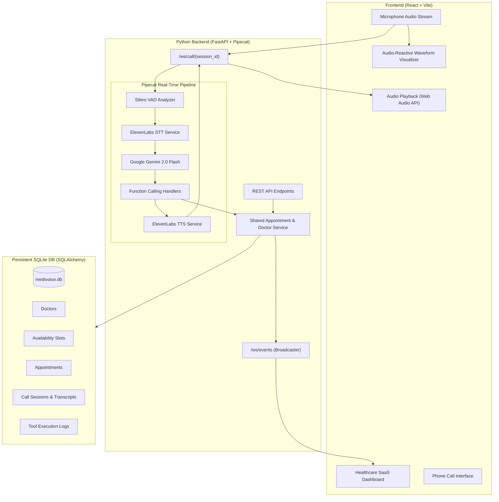

# MediVoice — System Architecture

## 1. Overview
MediVoice is an enterprise-grade Voice AI Doctor Appointment Assistant engineered to demonstrate the real-time voice pipeline lifecycle:
**Caller Audio → Speech Recognition (STT) → LLM Reasoning & Tool Calling → Atomic Database Execution → Voice Synthesis (TTS) → Real-Time Frontend Audio & State Reflection.**

---

## 2. Key Architecture Pillars

### 2.1 Separation of Concerns
1. **Frontend**: React + Vite single-page application with Tailwind CSS, Lucide icons, and Web Audio API analyser. Focuses purely on visual clarity, responsive interaction, audio-reactive waveform feedback, and reactive dashboard state.
2. **Backend**: Python 3.11 with FastAPI and Pipecat. Manages WebRTC / WebSocket audio transports, handles Silero VAD turn-taking, binds Gemini LLM function schemas, and coordinates tool execution.
3. **Shared Service Layer**: Both REST API endpoints and Pipecat voice function handlers call the exact same methods in `AppointmentService`. Zero duplicated business logic.
4. **Data Persistence**: SQLite managed via SQLAlchemy ORM with ACID transactions and unique constraints.

### 2.2 Concurrency & Atomic Booking
To eliminate race conditions when multiple callers attempt to reserve the same appointment slot simultaneously:
- Slot reservation uses database row transactions (`with_for_update` / atomic status transition).
- The `AvailabilitySlot` entity enforces unique constraints across `(doctor_id, appointment_date, start_time)`.
- If two calls request the same slot at the exact same millisecond, only the first transaction commits and transitions status from `Available` to `Booked`. The second request immediately fails with error code `SLOT_ALREADY_BOOKED` and advises the caller to pick an alternative.

### 2.3 Strict Caller Identification
- Callers are identified solely by their spoken 10-digit mobile number.
- No password or telephone caller-ID spoofing dependency.
- Spoken phone numbers are repeated back digit-by-digit (e.g. `9-8-7-6-5-4-3-2-1-0`) by the AI.
- The phone number confirmation and appointment booking authorization are two distinct sequential steps.
- Masking (e.g. `******3210`) is applied to all routine logs and frontend UI tables for privacy.
